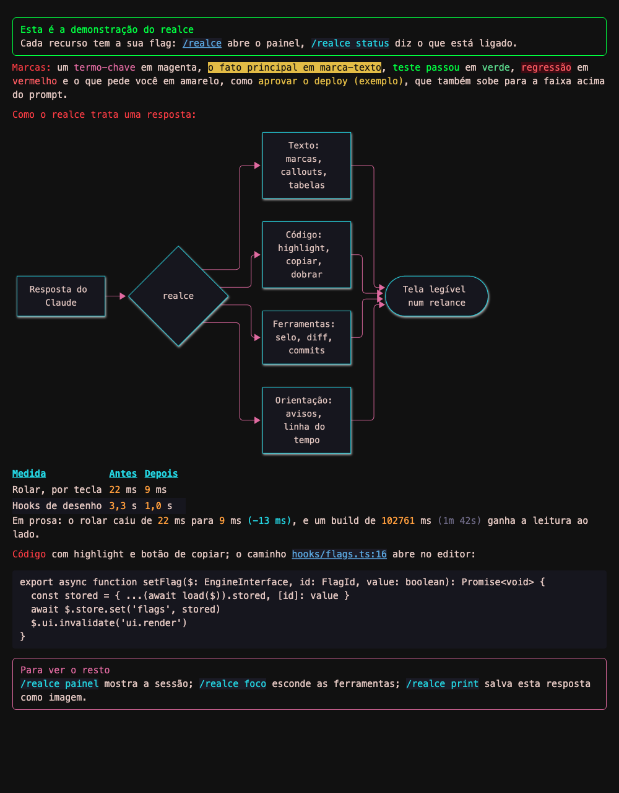
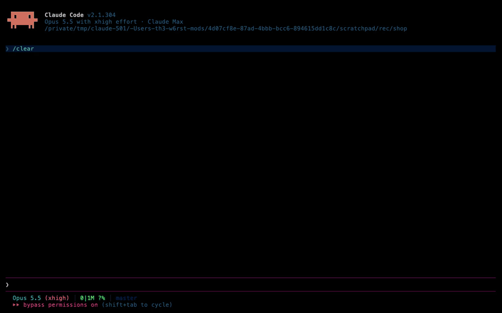
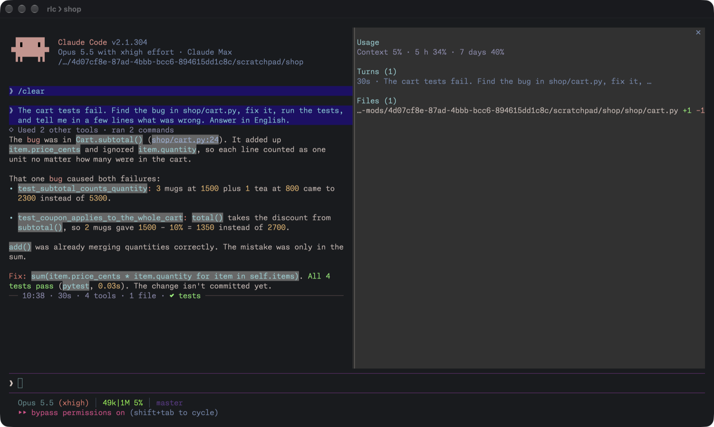
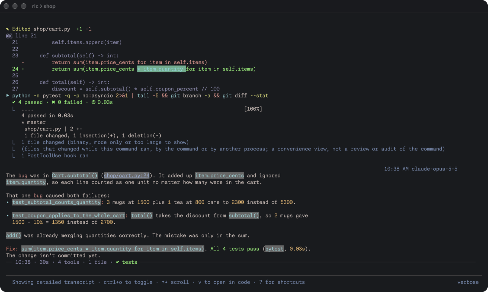

# realce

[](https://github.com/Th3-W6rst/claude-realce/actions/workflows/test.yml)

A Claude Code plugin (mod) that makes the screen easier to read. Every feature has its own flag and turns on or off
at once:

- colors by meaning in the replies, tables, decision and risk boxes, diagrams as pictures;
- code with its own highlighter, and diffs with word highlights;
- tools readable at a glance, and a **proof seal** that says whether what Claude claimed was tested;
- a spinner that says what is running ("Running the tests (last: 25s)"), and, if you want it, why each failed command
  failed;
- notices when Claude is done or asks something, and a pane with the session's usage, timeline and files.

The interface follows Claude Code's language: English, or Portuguese for whoever set Claude Code to Portuguese
(`/realce language en|pt|auto` picks one).



*Drawn by the mod itself, as `/realce print` draws a reply (`/realce demo` shows it in the terminal); the table's
numbers are just an example. On a light theme: [demo-light.png](images/demo-light.png).*

Current version: 0.5.6 · what's new in the [CHANGELOG](CHANGELOG.md) and in the
[releases](https://github.com/Th3-W6rst/claude-realce/releases) · repository:
[Th3-W6rst/claude-realce](https://github.com/Th3-W6rst/claude-realce) (questions and problems in *Issues*).

## Requirements

- **Claude Code 2.1.304 or newer** (`claude --version`), in the terminal. In the desktop and mobile apps the mod only
  turns Claude's marks into plain bold.
- **macOS** for the notices, the sound, the print and the paths that open in the editor. The rest works on any system.
- **A terminal with 24-bit color** (Ghostty, iTerm2, WezTerm, Kitty): `echo $COLORTERM` should answer `truecolor`.
- **Optional:** mermaid-cli, for diagrams and for the PNG of `/realce print` (see [Diagrams](#diagrams)).

## Install

At the prompt of a Claude Code session:

```
/plugin install realce --marketplace Th3-W6rst/claude-realce
```

Answer `y` to add the marketplace and press Enter on the user scope. From the shell, the same:
`claude plugin install realce --marketplace Th3-W6rst/claude-realce`. In the desktop app: + beside the prompt box,
Plugins, Add marketplace with `Th3-W6rst/claude-realce`, Add plugin.

**Once installed, close and reopen Claude Code.** The drawings already work in the session you installed it from,
but Claude only learns the colored marks in the next session.

Good to know before using it:

- Everything comes on, except focus mode, the sound, explained errors (`errors`) and the "Needs you" band
  (`pending`): those four are a matter of taste, and the last two add lines to every turn.
- The mod adds a short paragraph with the marks to the system prompt (only those of the features that are on).
- Two features call Haiku on your account, about one to two thousand tokens each time: `errors` (explains a command
  that failed, at most 20 each time the mod loads; off until you run `/realce errors on`) and `explain` (only when you
  ask).
- `/realce off` pauses everything; `claude plugin uninstall realce` removes it.

To update: `claude plugin marketplace update claude-realce`, then `claude plugin update realce@claude-realce`, and
reopen Claude Code. `/realce status` says when a new version is out.

## First steps

1. Run `/realce doctor` to see what your machine already has and what is missing, and `/realce demo` for a reply with
   every feature, without calling the model.
2. `/realce` opens the **flags pane**. `/realce pane` opens the **session pane**, which also opens by itself in a
   terminal 144 columns wide or more.
3. Ask Claude: *create sum.py with a sum function and a pytest test, and run the test*. While the test runs, the
   spinner says "Running the tests" (and, the second time, how long the last run took). The line that closes the turn
   (the **rule**: time, duration, tools) gets the seal `✔ proved`. If Claude edits and says it is done without
   testing, the seal is `⚠ no proof`.
4. `/realce help` lists the commands; `/realce status` shows what is on.

A **turn** is one message of yours and everything Claude does until it answers.

## In a session



*A turn recorded in a real session (Claude Code 2.1.304, 4× while Claude works; [MP4](images/session.mp4)): the tool
rows with the word diff, the reply colored by meaning, the rule that closes the turn with its proof seal, the detailed
transcript (ctrl+o) with the test score, the same turn with `/realce off` and back on, and the session pane.*



*A real session in Ghostty, on a small test project: the reply colored by meaning, the rule that closes the turn, and
the session pane with usage, turns and files. Below, the same turn in the detailed transcript (ctrl+o): the edit with
its word diff and the test run's score.*



## Commands

| Command | What it does |
|---|---|
| `/realce` | Opens the flags pane: each feature has a key (a letter or digit), the last ones only Tab and Enter; Esc closes |
| `/realce help` | Lists the commands |
| `/realce doctor` | Checks what your machine gives realce (version, colors, macOS, fullscreen, editor, mermaid, Chrome) and what is missing |
| `/realce on` · `/realce off` | Turns the whole mod on or off, keeping each flag's choice |
| `/realce <flag> on` · `off` | Turns one feature on or off, for example `/realce column off` |
| `/realce pane` | Opens or closes the session pane (usage, the explanation you asked for, plan, what needs you, pinned replies, timeline, files, failures with their why, agents) |
| `/realce copy` | Copies Claude's last reply (the marks become plain markdown) |
| `/realce summary` | Shows and copies a summary of the session in markdown: turns (time, duration, seal), tests, files, git, failures |
| `/realce focus` | Toggles focus mode, which hides the tools that finished without error |
| `/realce explain [text]` | Explains, in the session pane, the text you wrote, or the text selected in the conversation |
| `/realce pin` | Pins the selected reply, or the last one, in the pane; again, unpins it |
| `/realce print` | Saves the last reply as HTML and PNG on the Desktop, in your theme's colors |
| `/realce demo` | Shows a reply with every feature, without calling the model |
| `/realce status` | What is off, language, theme, fullscreen, notices, updates and the cost of each drawing |
| `/realce language en` · `pt` · `auto` | The interface's language; `auto` follows Claude Code's |

`copy`, `summary`, `pane`, `focus`, `pin`, `explain`, `print` and `demo` are flags too: `/realce focus` toggles the
mode, and `/realce explain off` turns the feature off (the command then says how to turn it back on). Two of them name
a part of the feature: `/realce copy off` takes the copy buttons away, while `/realce copy` still copies the last reply;
`/realce pane off` stops the pane from opening by itself, while `/realce pane` still opens it. Every command and flag
also answers to its Portuguese name (`/realce ajuda`, `/realce foco`, `/realce coluna off`).

## Features and flags

| Group | Flag | Feature | What it does | Default |
|---|---|---|---|---|
| Text | `emphasis` (`enfase`) | Colored emphasis | Claude's marks and automatic colors for numbers, paths and status | on |
| Text | `column` (`coluna`) | Reading column | Prose kept to 100 columns | on |
| Text | `callouts` | Callouts | Boxes for decision, risk, done, summary, note and tip | on |
| Text | `tables` (`tabelas`) | Colored tables | Highlighted header, striped rows, numbers on the right | on |
| Text | `deltas` | Automatic deltas | "from 87 to 106" gets (+19) | on |
| Text | `spacing` (`respiro`) | Room between items | A blank line between list items that wrap | on |
| Text | `numbers` (`numeros`) | Human numbers | "102761 ms" gets "(1m 42s)" beside it | on |
| Code | `highlight` | Own highlighter | Neon colors for ts, py, sh, json, yaml, swift, sql and diff | on |
| Code | `copy` (`copiar`) | One-click copy | A copy button on every code block and on long replies | on |
| Code | `fold` (`dobrar`) | Fold what is long | Blocks over 25 lines start folded | on |
| Code | `paths` (`caminhos`) | Clickable paths | Paths open in the editor, at the line | on |
| Code | `diagrams` (`diagramas`) | Diagrams | Mermaid blocks become pictures | on |
| Tools | `tools` (`ferramentas`) | Tools by kind | An icon and a color per kind; reads dimmed | on |
| Tools | `score` (`placar`) | Test score | The test summary above the Bash output | on |
| Tools | `rule` (`separador`) | Turn rule | A rule with the turn's time, duration and numbers | on |
| Tools | `agents` (`agentes`) | Agent cards | A background agent ends in a compact card | on |
| Tools | `seal` (`selo`) | Proof seal | The turn's rule says whether what Claude claimed was tested | on |
| Tools | `diff` | Readable diff | Edits with word highlights and line numbers | on |
| Tools | `errors` (`erros`) | Explained errors | A failed command gets one sentence saying why (Haiku) | off |
| Tools | `commits` | Commit cards | Commit, push and PR become a one-line card | on |
| Tools | `focus` (`foco`) | Focus mode | Hides the tools that finished without error | off |
| Guidance | `pending` (`pendencias`) | Needs you | A band above the prompt with what asks for your decision | off |
| Guidance | `plan` (`plano`) | Plan progress | A bar with the tasks while Claude works | on |
| Guidance | `pane` (`painel`) | Pane at start | Opens the session's side pane by itself | on |
| Guidance | `spinner` | Spinner that says what runs | "Thinking", "Writing" and what runs now ("Running the tests", "Editing x.ts") | on |
| Guidance | `notify` (`avisos`) | Notify when done | A macOS notification at the end of a long turn or on a question | on |
| Guidance | `sound` (`som`) | Notification sound | A short sound with the notification | off |
| Guidance | `away` (`ausencia`) | While you were away | What happened, once you start typing again | on |
| Guidance | `timeline` (`linha`) | Timeline | The turns in the pane, a click scrolls to each | on |
| Guidance | `questions` (`perguntas`) | Question header | A colored line above Claude's questions | on |
| Guidance | `pin` (`fixar`) | Pin replies | /realce pin keeps a reply in the pane | on |
| Guidance | `explain` (`explica`) | Explain this | /realce explain explains the selected text (Haiku) | on |
| Guidance | `limits` (`limite`) | Usage and limits | Usage in the pane; a band when a limit or the context nears its end | on |
| System | `theme` (`tema`) | Follow the theme | Colors for light backgrounds, color blindness and ANSI, from Claude Code's theme | on |
| System | `print` | Pretty print | /realce print saves the last reply as a picture | on |
| System | `demo` | Demo | /realce demo shows everything the mod does | on |
| System | `updates` (`atualizacao`) | Update notice | Says when a new version is out on GitHub | on |
| System | `summary` (`resumo`) | Session summary | /realce summary copies a summary of the session in markdown | on |

## Marks Claude starts to use

| Mark | Meaning | Color |
|---|---|---|
| `**Label:**` opening a line | Subtopic | red |
| `**term**` mid-sentence | Key term | magenta |
| `==fact==` | The most important fact of the reply | yellow highlighter |
| `{+text+}` | Went well | green |
| `{-text-}` | Went wrong | red on wine |
| `{!text!}` | Needs your attention or decision; with `pending` on, it also goes up to the "Needs you" band above the prompt | yellow |
| `> [!DECISION] …` | Decision box (also `RISK`, `DONE`, `SUMMARY`, `NOTE`, `TIP`; the Portuguese tags work too) | the kind's color |

With the seal on, Claude also knows the rule shows whether it ran the tests before saying it was done. With the mod
off, the marks show as plain bold. The colors follow Claude Code's theme (`/config`): dark, light, color-blind and
ANSI, `custom:` themes included through their `base` field.

## Diagrams

Optional. They need mermaid-cli and the headless browser it uses:

```sh
brew install mermaid-cli
npx -y @puppeteer/browsers install chrome-headless-shell@154.0.8037.57 --path ~/.cache/puppeteer
```

The browser version is the one mermaid-cli 12 asks for; if `mmdc` complains about another, install the one it names.
Without `mmdc` the feature stays quiet: Claude is not taught to draw diagrams, and mermaid blocks show as code. The
same browser makes the PNG of `/realce print`.

## What it reads, runs and sends

- **Processes:** `date`, `uname` and `defaults read -g AppleInterfaceStyle` (clock offset, platform, system theme);
  `which mmdc` and `mmdc` (mermaid-cli) to render diagrams into `~/.cache/realce/diagrams`; `osascript` for a macOS
  notification when the terminal has no notification channel; `afplay` for a sound (off by default); `find` to locate
  a headless Chrome for `/realce print` and to remove its own week-old perf files in `~/.cache/realce`; that headless
  Chrome, or Google Chrome run headless when there is none, to save `/realce print`'s PNG.
- **Files:** reads its own `plugin.json` and, for a `custom:` theme, `~/.claude/themes/<name>.json`; checks whether
  Cursor, Visual Studio Code or Zed is in `/Applications` (where paths open) and whether there is a Desktop. Writes
  under `~/.cache/realce/`; `/realce print` writes an HTML page and a PNG to the Desktop.
- **Settings:** reads Claude Code's `language` and `theme`.
- **Store:** its flags, the on/off switch, the language you picked, whether the welcome hint was shown and when it
  last looked for an update.
- **Session and clipboard:** reads the transcript and the selection (for copy, print, summary, explain and pin), and
  copies to the clipboard.
- **Network:** one GET of its own `plugin.json` from raw.githubusercontent.com, at most once a day, to say when a new
  version is out (`/realce updates off` stops it).
- **Model:** the Haiku, to explain a failed command (up to 20 each time the mod loads, with `/realce errors on`) and
  a selection on `/realce explain`.
- **Prompt:** one system prompt section that teaches Claude the marks; `/realce demo` submits one prompt, which the mod
  answers itself, without the model.
- **Environment:** reads `HOME` and `COLORTERM`.

Every one of these calls goes through [hooks/io.ts](hooks/io.ts); `claude plugin validate .` lists them all.

## Known limitations

- **Fullscreen** (`"tui": "fullscreen"` in `~/.claude/settings.json`): scrolling to a turn or a pinned reply, and
  selecting text for `/realce explain`, only work with it; without it, the mod says so.
- **Notify when done:** Claude Code does not say whether the window has focus; the notice goes out for turns longer
  than 1 minute and for questions asked after 1 minute of work. With no notification channel in the terminal (tmux,
  Terminal.app), it goes out as the macOS banner.
- **Proof seal:** tests run by a command in the background do not count; the seal stays at "⚠ no proof". It reads
  pytest, jest, vitest, bun, mocha, cargo, go test, XCTest, Swift Testing, `node --test`, RSpec and Deno.
- **Rule after a background agent:** Claude Code measures the turn an agent's notice opens from your last prompt, not
  that turn alone; its rule keeps the duration only.
- **Deltas:** "from 87 to 106" and an arrow with a unit ("22 ms → 9 ms") get their difference; an arrow between bare
  numbers ("4 → 8") does not, since it is usually an input → output.
- **A diagram while the reply streams:** until the reply is done, the mermaid block shows as code.
- **Questions:** Claude Code does not let the question dialog be redrawn; the mod only adds a line above it.
- **Agent card:** it depends on the notice's text; in a format the mod does not know, Claude Code's drawing stays.

Performance: with the mod on, typing and scrolling take as long as with `/realce off`. To work on the mod, see
[CONTRIBUTING](CONTRIBUTING.md).

## License

[MIT](LICENSE).
